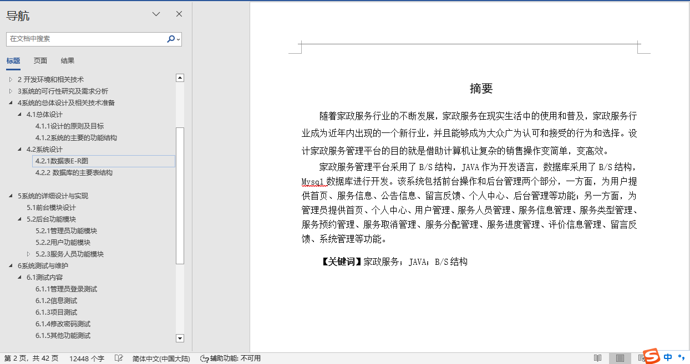
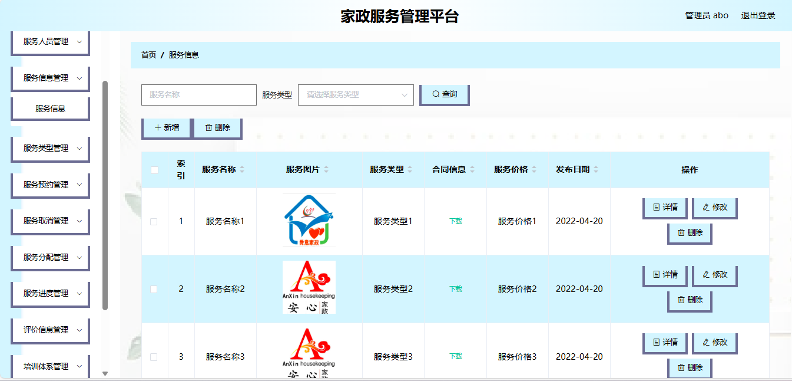
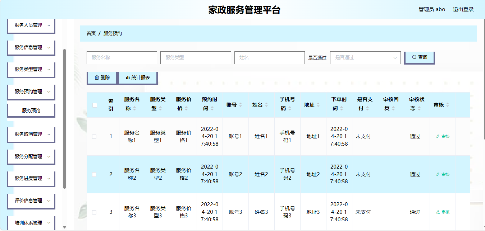
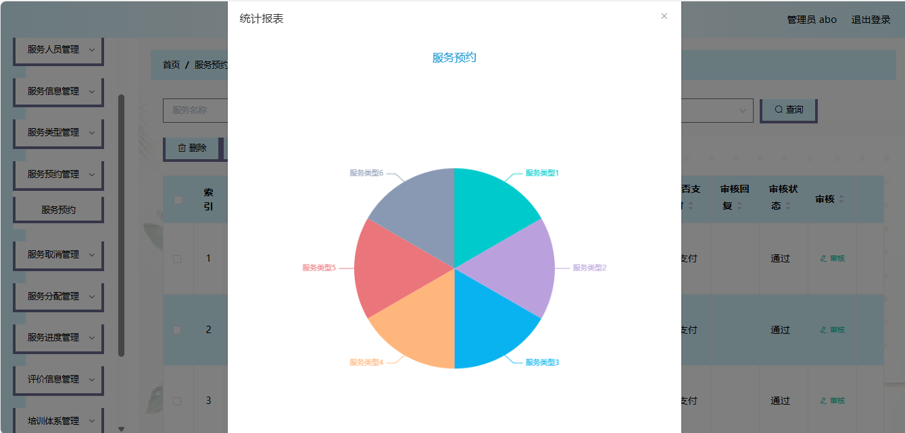
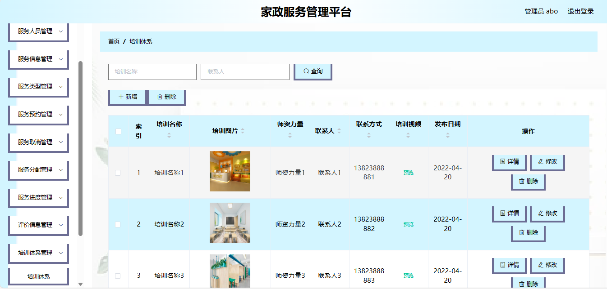
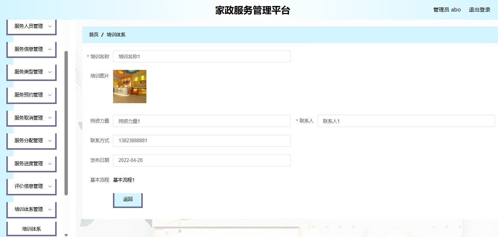
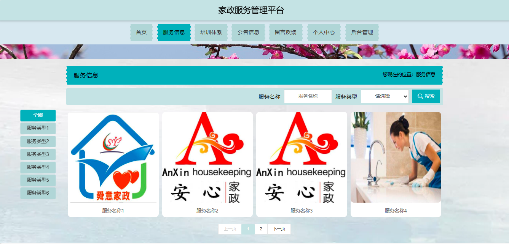
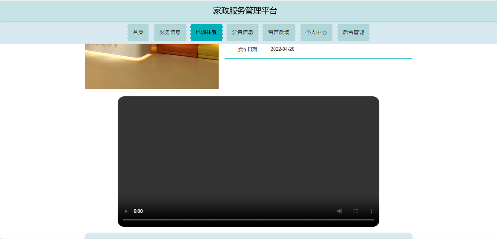
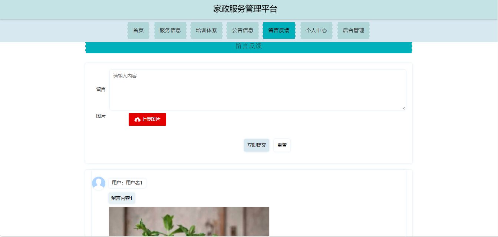
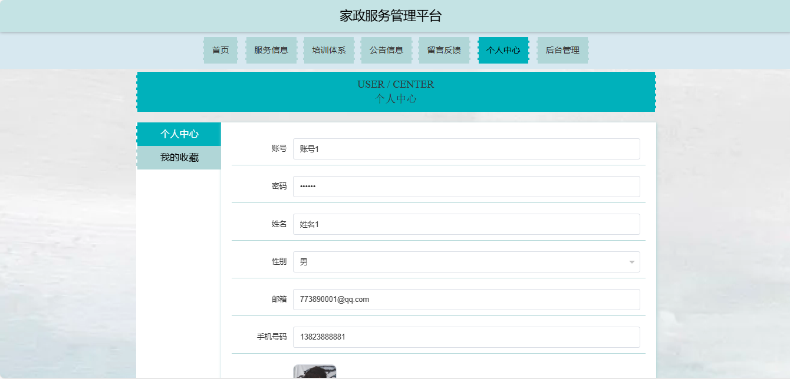

## 基于springboot的家政服务管理平台(程序+报告)

###  获取完整源码和sql数据库文件（完全免费）: 微信: littlepinia88 程序员蛙哥
###  所有项目以及源代码本人均调试运行无问题 可支持远程安装部署调试、定制修改、代码讲解

## 项目介绍

本项目是一个基于 Spring Boot 的家政服务管理平台，面向家政公司在线接单、派单与服务跟进场景，采用「用户端静态门户 + 管理端 Vue 后台」结构：居民在线浏览家政服务、预约下单，服务人员接单上门并反馈进度，管理员在后台完成审核派单、进度调度与评价管理。系统打通了服务浏览、在线预约、后台派单、上门服务、进度更新、用户评价的家政业务闭环，后端基于 Spring Boot + MyBatis-Plus 提供 RESTful 数据接口，可作为课程设计、毕业设计或生活服务类系统实践案例。

### 系统角色
- **管理员**：通过 `users` 表账号登录管理端，维护服务类型、服务信息、预约单、派单、进度与评价。
- **服务人员**：通过 `fuwurenyuan` 表账号（可自助注册）登录用户端，查看分配给自己的服务并更新服务进度。
- **居民用户**：通过 `yonghu` 表注册登录，浏览服务、下单预约、取消订单、评价服务与留言反馈。
- **权限控制**：由 `AuthorizationInterceptor` 基于请求头 `Token` 校验登录态，登录成功后令牌写入 `token` 表；标注 `@IgnoreAuth` 的接口放行，其余需登录；系统仅按登录身份区分入口，未做接口级角色权限校验。

### 用户端功能
1. **注册与登录**：居民与服务人员均可注册，居民维护姓名、性别、电话，服务人员维护工号、相片与联系手机；登录成功后返回 token。
2. **服务浏览**：按服务类型筛选，分页浏览服务列表，详情页查看服务图片、合同信息、价格、简介与详情。
3. **服务预约**：选择预约时间、填写地址与联系方式下单，提交后状态为待审核（`sfsh`）。
4. **服务取消**：对待处理订单提交取消申请并填写取消原因，待后台审核。
5. **服务进度**：查看后台分配的服务人员（工号、姓名、联系手机）、服务内容与进度更新时间。
6. **服务评价**：服务完成后对本次服务提交评价内容与评价日期。
7. **留言反馈**：提交留言（可附图片），查看管理员回复（可附回复图片）。
8. **培训体系**：浏览家政培训基本流程、师资力量、联系人与培训视频。
9. **公告与收藏**：浏览平台公告资讯、收藏感兴趣的服务。

### 管理端功能
1. **管理员登录/注销**：独立登录页，登录后进入 Vue 后台首页。
2. **用户管理**：居民账号分页查询、编辑与删除。
3. **服务人员管理**：服务人员账号分页管理，维护工号、姓名、联系手机与相片。
4. **服务类型管理**：服务类型字典的增删改查与分页。
5. **服务信息管理**：上架家政服务，上传服务图片，维护价格、合同信息与详情。
6. **服务预约管理**：查看全部预约单，执行审核。
7. **服务分配**：把预约单指派给具体服务人员（记录工号、员工姓名与分配日期）。
8. **服务进度管理**：维护各订单的服务内容与进度状态。
9. **服务取消管理**：审核用户提交的取消申请。
10. **评价管理**：查看用户评价并删除不当评价。
11. **留言管理**：查看用户留言并回复。
12. **培训体系管理**：培训图文与培训视频的增删改查。
13. **公告与配置管理**：公告资讯、收藏记录与轮播图配置维护。

### 技术栈
- **后端框架**：Spring Boot 2.2.2.RELEASE（Java 8）、Spring MVC REST 接口
- **数据访问**：MyBatis-Plus 2.3（mybatisplus-spring-boot-starter 1.0.5）配合 mybatis-spring-boot-starter 2.1.1，Mapper XML 位于 `classpath*:mapper/*.xml`，MySQL 数据库
- **前端**：管理端 Vue 2.6.10 + Element UI 2.13.0 + vue-router 3.1.5 + axios 0.19.2 + ECharts 4.6.0；用户端 Layui + Vue2 静态页面（内置 Tinymce 富文本编辑器）
- **工程能力**：自定义 `AuthorizationInterceptor` 令牌拦截器、`@IgnoreAuth` 放行注解、统一 `R` 响应模型、`FileController` 文件上传（保存至 `static/upload`）、FastJSON 序列化、Hutool 工具集
- **构建运行**：Maven 构建，`spring-boot-maven-plugin` 打包为可执行 jar；管理端为 Vue 工程构建后的 `dist` 静态包，随后端一起部署

### 核心数据表
- `users` 管理员表：用户名 `username`、密码 `password`、角色 `role`
- `yonghu` 用户表：姓名 `xingming`、性别、邮箱 `youxiang`、手机号码 `shoujihaoma`、相片 `xiangpian`
- `fuwurenyuan` 服务人员表：密码 `mima`、员工姓名 `yuangongxingming`、联系手机 `lianxishouji`、相片 `xiangpian`
- `fuwuleixing` 服务类型表：类型名称
- `fuwuxinxi` 服务信息表：服务图片 `fuwutupian`、服务类型、合同信息 `hetongxinxi`、服务价格 `fuwujiage`、服务简介 `fuwujianjie`、服务详情 `fuwuxiangqing`
- `fuwuyuyue` 服务预约表：服务类型/价格、预约时间 `yuyueshijian`、地址 `dizhi`、是否审核 `sfsh`、审核回复 `shhf`、是否支付 `ispay`
- `fuwufenpei` 服务分配表：账号、姓名、工号 `gonghao`、员工姓名 `yuangongxingming`、分配日期 `fenpeiriqi`
- `fuwujindu` 服务进度表：服务进度 `fuwujindu`、服务内容 `fuwuneirong`、更新时间 `gengxinshijian`
- `fuwuquxiao` 服务取消表：取消原因 `quxiaoyuanyin`、取消日期 `quxiaoriqi`、是否审核 `sfsh`
- `pingjiaxinxi` 评价表：评价内容 `pingjianeirong`、评价日期 `pingjiariqi`
- `messages` 留言反馈表：留言内容 `content`、留言图片 `cpicture`、回复 `reply`
- `peixuntixi` 培训体系表：基本流程 `jibenliucheng`、师资力量 `shizililiang`、培训视频 `peixunshipin`
- `news` 公告表、`storeup` 收藏表、`token` 登录令牌表、`config` 系统配置表

### 工程结构
```
A010springbootm7qt4
├── src/main/java/com
│   ├── controller/     REST 控制器（用户、服务人员、服务、预约、分配、进度、取消、评价、留言）
│   ├── service/        业务接口与 impl 实现
│   ├── dao/            MyBatis-Plus Mapper 接口
│   ├── entity/         实体类（model/view/vo 分层）
│   ├── interceptor/    AuthorizationInterceptor 令牌拦截
│   ├── config/         拦截器注册与 MyBatis-Plus 配置
│   ├── annotation/     @IgnoreAuth、@LoginUser 注解
│   └── utils/          R 响应、分页、文件上传等工具类
├── src/main/resources
│   ├── mapper/         MyBatis Mapper XML
│   ├── admin/admin/    管理端 Vue2 工程（src 源码 + dist 构建产物）
│   ├── front/front/    用户端 Layui + Vue 静态页面
│   ├── static/upload/  上传文件目录
│   └── application.yml  端口、数据源、MyBatis-Plus 配置
├── screenshot/          运行截图
└── pom.xml
```

### 访问入口
- 管理端：`http://localhost:8080/springbootm7qt4/admin/admin/dist/index.html`
- 用户端：`http://localhost:8080/springbootm7qt4/front/front/index.html`

### 补充说明
- 端口 8080、访问前缀 `/springbootm7qt4`、数据库 `a010_springbootm7qt4`（root/123456）均在 `application.yml` 中配置，首次运行需先创建数据库并导入 SQL 脚本，账号密码按本机 MySQL 环境调整。
- 登录鉴权基于自定义令牌（`token` 表），未使用 Shiro/Spring Security；用户与服务人员密码均以明文形式比对、入库。
- 预约单的 `ispay` 仅为支付状态字段，未接入真实支付渠道；拦截器在响应头统一放行跨域（`Access-Control-Allow-Origin` 直接回显请求来源），且只校验「是否登录」，不区分服务人员与管理员的接口权限。
- 上传图片与课件保存在本地 `static/upload` 目录，未接入对象存储。

## 运行环境
- JDK版本：JDK1.8及以上
- 开发工具：IDEA、Ecplise、Myecplise都可以
- 数据库: MySQL5.7及以上
- Node：14.14.0及以上

## 运行截图



















